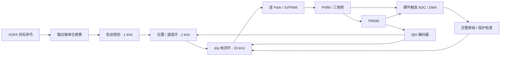

<div align="center">

# Motor Control

**基于 HPM6E 系列 RISC-V MCU 的 PMSM 伺服控制固件**

从同步采样到三环闭环，从 S 曲线规划到实时波形调试。


[功能概览](#功能概览) · [快速开始](#快速开始) · [VOFA 调试](#vofa-调试) · [测试](#测试) · [文档导航](#文档导航)

</div>

本项目将 PWM、ADC、ABZ 编码器、FOC 算法与运动控制组织为独立模块，支持电流、速度和位置控制。实时控制使用电机轴编码器计数及 mA，VOFA 接口负责输出轴 rpm 和角度的换算，便于分别调试算法、驱动与上位机。

> **仓库分发范围：**`.cache/`、`tests/`、`build.cmd`、`build.ps1`、`organize_ses.py` 和 README 以外的 Markdown 说明仅保留在本地，不纳入 Git。下文的脚本构建、主机测试及详细说明面向完整本地工作区；新克隆仓库需另行补齐相关文件。当前 CMake 配置也会调用 `organize_ses.py`，缺少该文件将无法完成配置。

## 功能概览

| 模块 | 能力 |
| --- | --- |
| FOC 电流环 | Clarke / Park、d/q 双 PI、逆 Park、SVPWM，默认 20 kHz |
| 速度与位置环 | 默认 1 kHz；位置 PI 与规划速度前馈串接速度环 |
| 轨迹规划 | 速度模式加加速度约束过渡、位置模式七段 S 曲线，支持往返、驻留和循环次数 |
| 同步采样 | PWM 硬件触发双路电流 ADC，DMA 完整帧驱动控制计算 |
| 编码器反馈 | QEI ABZ 反馈、累计位置、圈内相位与速度估计 |
| 初始化 | 电流零偏标定、上电对齐、降流关桥、编码器清零与 READY 门禁 |
| 运行保护 | 相电流 / d-q 过流、超速、母线与温度、数据有效性及控制心跳检查 |
| 实时调试 | VOFA JustFloat 12 通道上传，串口命令切换控制模式与目标 |
| 主机回归 | PI / SVPWM、保护、轨迹、编码器、ADC 同步与控制集成测试 |

> **启动行为：**上电准备会自动通电执行一次对齐，对齐完成后降流并关桥；进入 READY 后，`ENABLE,1` 才启动所选运行模式。`MOTOR_AUTO_RUN=0` 不代表上电对齐过程不通电。

## 控制架构



电流模式直接提供 Iq 目标；速度模式经规划器和速度 PI 生成 Iq；位置模式由规划位置与速度前馈驱动外环。控制计算由完整 ADC 新帧推进，主循环负责准备流程、采样维护及 VOFA 通信，PWM 独立中断检查控制心跳。

## 快速开始

### 1. 准备开发环境

当前构建脚本面向 **Windows + PowerShell**，需要完整的 **HPM SDK 1.9.x 开发环境包**：

- `hpm_sdk/`：SDK、驱动与构建配置。
- `hpm_apps/`：应用依赖，包括 `hpm_motor` 与 `vofa_debug` 中间件。
- `tools/`：CMake、Ninja、Python。
- `toolchains/rv32imac_zicsr_zifencei_multilib_b_ext-win/`：RISC-V GCC 工具链。

板级构建名称为 `hpm6e00sip_pmsm`，使用仓库中的 `boards/` 配置。烧录脚本当前指定 J-Link 设备 `HPM6E80xVMx`、JTAG 接口；迁移到其他硬件时需同步调整板级引脚、采样电路参数与调试器设置。

### 2. 构建固件

在仓库根目录运行，将 SDK 路径替换为本机环境包根目录：

```powershell
.\build.ps1 -SdkRoot 'D:\SDK\hpm_sdk_env_v1.9.0'
```

只配置工程、不编译：

```powershell
.\build.ps1 -SdkRoot 'D:\SDK\hpm_sdk_env_v1.9.0' -ConfigureOnly
```

脚本检查依赖与 SDK 版本，配置 `flash_xip` 工程，并在 `build/` 下生成编译产物、`compile_commands.json` 和 SEGGER Embedded Studio 工程。默认 SDK 路径仍是原开发机路径；`build.cmd` 也可作为入口并转发参数。

构建脚本会将本地 `board.h` 中的 `MOTOR_USE_TRAJECTORY` 设为 `1`、`MOTOR_AUTO_RUN` 设为 `0`。保留的 `core/` 扩展由 CMake 选项 `MOTOR_CONTROL_BUILD_MOTOR` 管理，默认关闭；当前 FOC、三环控制、轨迹和保护模块默认参与构建。

### 3. 下载与调试

工程提供 `flash` 目标，执行后会下载并运行固件：

```powershell
& 'D:\SDK\hpm_sdk_env_v1.9.0\tools\cmake\bin\cmake.exe' --build build --target flash
```

需要已安装的 J-Link；路径与设备配置位于 [hpm_flash.cmake](.vscode/hpm_flash.cmake)。VS Code 也提供构建、配置与 `HPM: Flash and run (J-Link)` 任务；换机器后请同步检查 `.vscode/` 中的 SDK、工具链和调试器路径。

首次运行前，按实际电机核对 [motor_config.h](motor/inc/motor_config.h) 中的极对数、编码器方向、采样比例、PI 与保护门限。上电对齐会产生转矩，需为转轴留出运动空间。

## VOFA 调试

默认串口参数为 **115200 bit/s · JustFloat · 12 通道 · 100 Hz 上传**。上传频率独立于 20 kHz 电流环与 1 kHz 外环；串口与引脚以本地板级配置为准。

### 控制命令

每条命令以实际的 CR 或 LF 结束。确认 `pmsm_init_monitor.state` 为 `READY`（值为 `3`），或通过 `pmsm_is_ready()` 查询后，再发送目标与使能命令。

| 命令 | 行为 |
| --- | --- |
| `SET,CURRENT_MA,200` | 选择电流模式，设置 Iq 目标为 200 mA |
| `SET,SPEED_RPM,10` | 选择速度模式，设置输出轴目标为 10 rpm |
| `SET,POSITION_DEG,90` | 选择位置模式，设置输出轴累计绝对位置为 90° |
| `ENABLE,1` | 准备完成且门禁通过后启动所选模式 |
| `ENABLE,0` / `STOP` | 立即关桥，清除目标并取消当前轨迹 |
| `CLEAR_FAULT` | 尝试清除故障，不自动恢复使能或旧目标 |

例如，在 READY 后依次发送以下两行，启动 200 mA 电流模式：

```text
SET,CURRENT_MA,200
ENABLE,1
```

位置以本次上电对齐清零位置为原点，360° 表示输出轴一圈，720° 表示两圈。零速或零位置目标仍是闭环控制目标；需要关桥时使用 `STOP`。

准备期间的使能请求被拒绝，不会排队。若 STOP 取消了上电准备，需要显式重新准备或复位；普通 READY 后停机再使能不会重复对齐。

### 波形通道

| 通道 | 信号 | 单位 |
| --- | --- | --- |
| CH0 / CH1 | Id 目标 / 实际 | mA |
| CH2 / CH3 | Iq 目标 / 实际 | mA |
| CH4 / CH5 | Ud / Uq | PWM 计数 |
| CH6 | 输出轴实际转速，未滤波 | rpm |
| CH7 | 故障位，含启动禁止故障 | 位掩码 |
| CH8 / CH9 | 速度目标 / 滤波反馈 | 输出轴 rpm |
| CH10 / CH11 | 位置目标 / 实际位置 | 输出轴累计角度，° |

## 参数入口

常用参数集中于 [motor/inc/motor_config.h](motor/inc/motor_config.h)，修改后重新构建和下载。

| 配置 | 当前默认值 |
| --- | --- |
| PWM / 电流环频率 | 20 kHz |
| 速度 / 位置环频率 | 1 kHz |
| 极对数 / ABZ 每圈计数 | 14 / 4000（含四倍频） |
| 电机轴与输出轴减速比 | 7.75 |
| 直接 Iq 命令 / 速度 PI 输出限幅 | ±1000 mA |
| 相电流 / d-q 过流门限 | 3000 mA |
| 速度模式命令上限 | 输出轴约 ±100 rpm |
| 位置轨迹峰值速度 | 20000 电机轴计数/秒 |
| 位置往返循环 | 默认关闭，单次运动 |

PI 的 Ki 使用各控制环的**每拍积分增益**，不需要再次乘控制周期。母线和温度保护门限使用 ADC 原始码；当前欠压门限默认 `0`，没有有效欠压门限。参数需结合采样电路和负载整定，主机模型回归不能替代上板测量。

## 测试

主机测试通过 MATLAB 随附的 LCC64 编译器运行，脚本默认路径为 `C:\Program Files\MATLAB\R2025b\sys\lcc64\lcc64`，可用 `-LccRoot` 指定其他安装位置。部分测试还需要完整 SDK，可用 `-SdkRoot` 指定。

```powershell
.\tests\run_pmsm_control_tests.ps1
.\tests\run_pmsm_protect_tests.ps1
.\tests\run_pmsm_trajectory_tests.ps1
.\tests\run_encoder_position_tests.ps1
.\tests\run_adc_pwm_sync_tests.ps1
.\tests\run_pwm_adc_timing_tests.ps1 -SdkRoot 'D:\SDK\hpm_sdk_env_v1.9.0'
.\tests\run_current_ctrl_tests.ps1 -SdkRoot 'D:\SDK\hpm_sdk_env_v1.9.0'
```

测试覆盖算法、控制集成与模拟外设行为。电流环集成测试默认对离线模型单独使用位置 Kp `0.00205f`，不修改固件配置中的位置 Kp。测试与构建生成的中间产物位于 `.cache/` 和 `build/`。

## 目录结构

```text
motor_control/
├── app/                 # 应用入口、PWM / ADC / QEI 驱动、VOFA 接口与 CMake
├── motor/               # FOC、PI、三环控制、轨迹、保护及统一参数
├── core/                # 保留的 3P3Z、参数检测与惯量辨识扩展
├── boards/              # 本地 hpm6e00sip_pmsm 板级配置
├── tests/               # 主机回归、外设桩与 PowerShell 测试入口
├── .vscode/             # 构建任务、工具链、调试及烧录配置
├── build.ps1            # SDK 检查、工程配置与构建入口
├── build.cmd            # Windows 构建包装入口
├── organize_ses.py      # SEGGER 工程分组整理
├── build/               # 本地构建产物
└── .cache/              # 主机测试与临时验证产物
```

`.cache/` 整体由 Git 忽略，其中 `simulink_compare/` 是固件与 Simulink 代码的临时对比目录，不属于正式构建依赖。上表中的测试目录和辅助脚本仅保留在完整本地工作区；VS Code 的文件隐藏设置与 Git 忽略规则分别生效。

## 文档导航

| 文档 | 内容 |
| --- | --- |
| `电流环移植说明.md` | 当前闭环架构、上电准备、三环单位、VOFA 与验证说明 |
| `轨迹规划移植说明.md` | S 曲线、目标重规划、往返循环与运行时配置接口 |
| `保护模块说明.md` | 保护输入、门限、故障锁存与清除 |
| `ADC_PWM同步采样说明.md` | 硬件触发、完整帧处理与同步采样 |
| `PI_SVPWM移植说明.md` | 基础控制算法与移植背景 |
| `PWM_ADC移植交接.md` | 外设移植背景与交接记录 |
| `PWM移植说明.md` | PWM 驱动的移植记录 |

以上说明仅保留在本地，远程仓库不提供对应文件。移植记录保留了不同阶段的实现背景；当前行为以源码与统一参数配置为准。
